 <div align="center">

# 🚀 DevSecOps Portfolio — Ghazi Arif

**Infrastructure DevSecOps complète — 42 étapes, 10 blocs, du serveur Ubuntu à l'orchestration Docker.**

[](https://ubuntu.com/)
[](https://www.docker.com/)
[](https://www.jenkins.io/)
[](https://nextjs.org/)
[](https://nodejs.org/)
[](https://www.ansible.com/)
[](https://www.vagrantup.com/)

[📖 Documentation](#-table-des-matières) · [🐛 Issues](https://github.com/ghaziarif1/devsecops-portfolio/issues) · [✨ Pull Requests](https://github.com/ghaziarif1/devsecops-portfolio/pulls)

</div>

---

## 📋 Table des matières

<details open>
<summary><b>Cliquez pour déplier / replier</b></summary>

- [Aperçu du projet](#-aperçu-du-projet)
- [Stack technique](#-stack-technique)
- [Architecture](#-architecture)
- [Structure du dépôt](#-structure-du-dépôt)
- [Installation rapide](#-installation-rapide)
- [Les 42 étapes](#-les-42-étapes)
  - [I. Infrastructure](#i-infrastructure)
  - [II. Dockerisation](#ii-dockerisation)
  - [III. Vagrant](#iii-vagrant)
  - [IV. Portfolio HTML/CSS/JS](#iv-portfolio-htmlcssjs)
  - [V. Migration Next.js](#v-migration-nextjs)
  - [VI. Jenkins Pipeline](#vi-jenkins-pipeline)
  - [VII. Ansible](#vii-ansible)
  - [VIII. API Express](#viii-api-express)
  - [IX. Variables d'environnement](#ix-variables-denvironnement)
  - [X. Dockerisation complète](#x-dockerisation-complète)
- [Compétences démontrées](#-compétences-démontrées)
- [Auteur](#-auteur)

</details>

---

## 🎯 Aperçu du projet

Ce dépôt retrace **la construction complète d'une infrastructure DevSecOps** de bout en bout, divisée en 42 étapes réparties en 10 blocs.

<table>
<tr>
<td width="50%">

### 🎨 Deux versions du Portfolio

- **HTML/CSS/JS** — Version statique conteneurisée avec Nginx.
- **Next.js 16** — Version moderne avec composants réutilisables et routes dynamiques.

### 🐳 Conteneurisation complète

- Image `devsecops-portfolio` (frontend Next.js multi-stage).
- Image `devsecops-api` (API Express).
- Orchestration via Docker Compose.

</td>
<td width="50%">

### ⚙️ Automatisation

- **Jenkins** — Pipeline CI/CD Multibranch.
- **Ansible** — Playbooks idempotents.
- **Vagrant** — VM reproductible.

### 🔗 API REST intégrée

- 4 routes : `/api/health`, `/api/profile`, `/api/projects`, `/api/skills`.
- Frontend consommant l'API via `NEXT_PUBLIC_API_URL`.
- Communication inter-conteneurs via réseau Docker.

</td>
</tr>
</table>

---

## 🛠 Stack technique

| Domaine | Technologies |
|:--------|:-------------|
| **Système** |  |
| **Conteneurisation** |    |
| **Frontend v1** |    |
| **Frontend v2** |    |
| **Backend** |   |
| **CI/CD** |  |
| **IaC** |    |
| **Versioning** |   |

---

## 🏗 Architecture

```text
┌──────────────────────────────────────────────────────────────┐
│ VM Ubuntu 26.04 — 192.168.109.128                            │
│                                                              │
│  ┌──────────────┐  ┌─────────────────┐  ┌─────────────────┐  │
│  │ Jenkins      │  │ Portfolio HTML  │  │ Portfolio       │  │
│  │ :8080        │  │ Docker :8081    │  │ Next.js :3002   │  │
│  │ (Java 21)    │  │ (Nginx)         │  │ (Docker)        │  │
│  └──────────────┘  └─────────────────┘  └────────┬────────┘  │
│                                                  │           │
│                                       ┌──────────▼────────┐  │
│                                       │ API Express       │  │
│                                       │ Docker :4000      │  │
│                                       │ (Node.js 22)      │  │
│                                       └───────────────────┘  │
│                                                              │
│  Réseau Docker : devsecops-net                               │
│                                                              │
│  ┌────────────────────┐                                      │
│  │ VM admin (clone)   │  Ansible pilote la VM principale    │
│  │ 192.168.109.130    │  via SSH                            │
│  └────────────────────┘                                      │
└──────────────────────────────────────────────────────────────┘
                              │
                              ▼
                         ┌─────────┐
                         │ GitHub  │
                         └─────────┘
                              ▲
                              │
                       Pipeline CI/CD
                           Jenkins
```

---

## 📁 Structure du dépôt

```text
devsecops-portfolio/
│
├── README.md
├── .gitignore
├── Jenkinsfile
├── docker-compose.yml
│
├── html-version/
│   ├── index.html
│   ├── Dockerfile
│   ├── docker-compose.yml
│   └── .dockerignore
│
├── next-version/
│   ├── app/
│   │   ├── layout.tsx
│   │   ├── page.tsx
│   │   └── projects/
│   │       ├── page.tsx
│   │       └── [slug]/page.tsx
│   ├── components/
│   │   ├── Header.tsx
│   │   ├── About.tsx
│   │   ├── Skills.tsx
│   │   ├── DevSecOpsSkills.tsx
│   │   ├── Projects.tsx
│   │   ├── Experience.tsx
│   │   ├── Contact.tsx
│   │   └── Footer.tsx
│   ├── data/
│   ├── public/
│   ├── Dockerfile
│   ├── .dockerignore
│   ├── .env.example
│   ├── next.config.ts
│   ├── package.json
│   └── tsconfig.json
│
├── api/
│   ├── src/
│   │   ├── index.js
│   │   ├── routes/
│   │   │   ├── health.js
│   │   │   ├── profile.js
│   │   │   ├── projects.js
│   │   │   └── skills.js
│   │   └── data/
│   │       ├── profile.json
│   │       ├── projects.json
│   │       └── skills.json
│   ├── Dockerfile
│   ├── .dockerignore
│   ├── .env.example
│   └── package.json
│
└── images/
    └── captures des étapes du projet
```

---

## ⚡ Installation rapide

### 🐳 Lancer la version HTML/CSS/JS

```bash
cd html-version
docker compose up -d
```

Accès : `http://<IP_VM>:8081`

### ⚛️ Lancer la version Next.js en développement

```bash
cd next-version
npm install
npm run dev -- -H 0.0.0.0
```

Accès : `http://<IP_VM>:3000`

### 🚀 Lancer la stack complète (frontend + API)

Depuis la racine du dépôt :

```bash
docker compose up -d
docker compose ps
```

Accès :

- Frontend : `http://<IP_VM>:3002`
- API Health : `http://<IP_VM>:4000/api/health`

---

# 📚 Les 42 étapes

## I. Infrastructure

### 1️⃣ Installation Ubuntu Server et SSH

Installation d'Ubuntu Server 26.04 LTS avec OpenSSH activé et pare-feu UFW configuré.

```bash
sudo apt install openssh-server
sudo systemctl enable --now ssh
sudo ufw allow ssh
sudo ufw enable
```

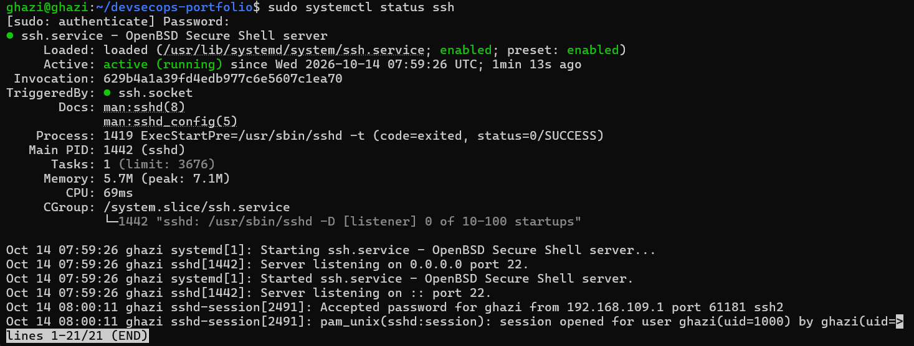

### 2️⃣ Test SSH depuis la machine physique

```powershell
ssh ghazi@192.168.109.128
```

Connexion réussie sur Ubuntu.

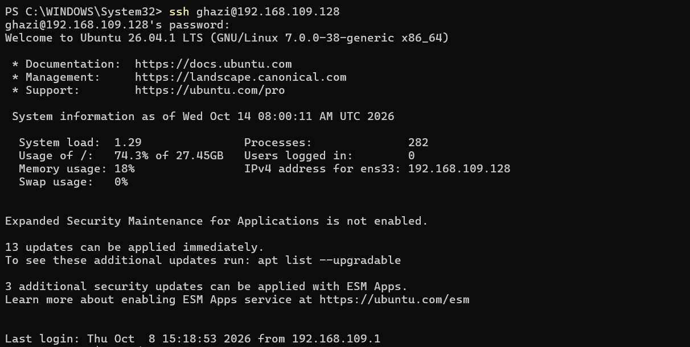

### 3️⃣ Installation Docker

Installation de Docker Engine et du plugin Docker Compose depuis le dépôt officiel.

```bash
sudo apt install docker-ce docker-ce-cli containerd.io \
  docker-buildx-plugin docker-compose-plugin

sudo docker run hello-world
```

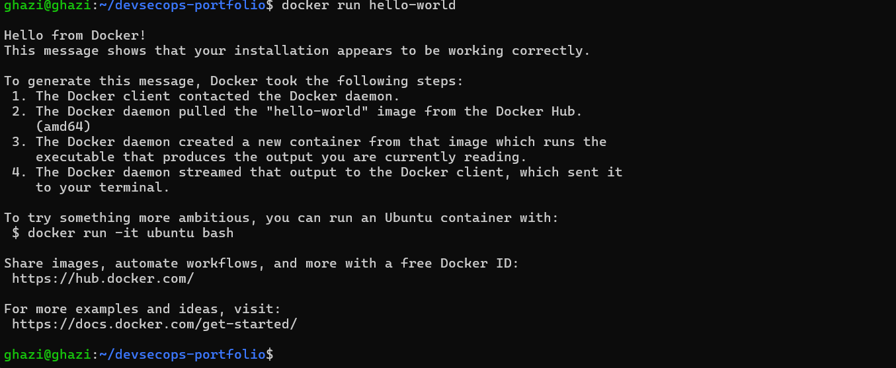

### 4️⃣ Installation Jenkins

Java 21 est utilisé pour Jenkins.

```bash
sudo apt install -y openjdk-21-jdk

curl -fsSL https://pkg.jenkins.io/debian-stable/jenkins.io-2026.key \
  | sudo tee /usr/share/keyrings/jenkins-keyring.asc > /dev/null

sudo apt install -y jenkins
sudo systemctl enable --now jenkins
```

Accès : `http://192.168.109.128:8080`

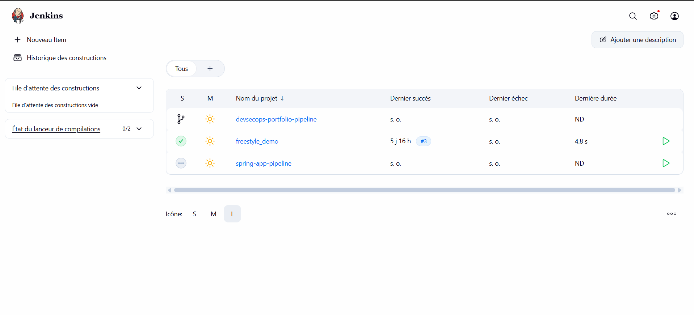

---

## II. Dockerisation

### 5️⃣ Mini CV One Page

Création d'une première version du CV en HTML5, CSS3 et JavaScript.


### 6️⃣ Push GitHub via SSH

Génération d'une clé Ed25519, ajout de la clé publique dans GitHub et test de connexion.

```bash
ssh-keygen -t ed25519 -C "ghaziarif2003@gmail.com"
ssh -T git@github.com
```

Résultat attendu :

```text
Hi ghaziarif1! You've successfully authenticated...
```

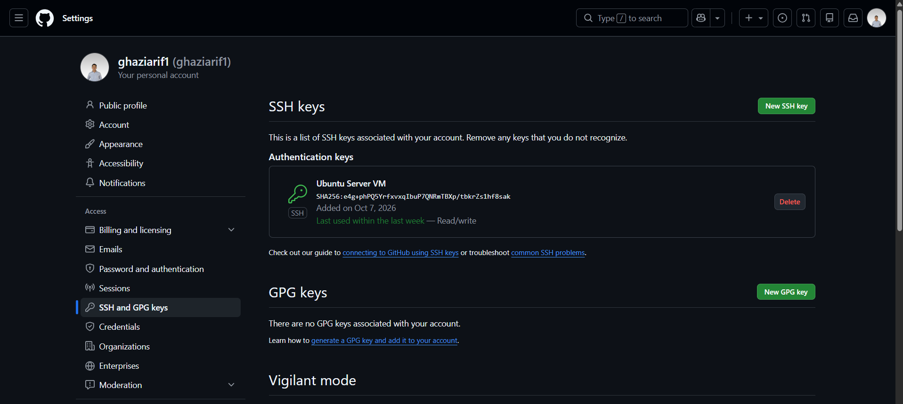

### 7️⃣ Évolution en DevSecOps Portfolio

| Amélioration | Description |
|---|---|
| CV → Portfolio interactif | Navigation, animations et cartes cliquables |
| Design responsive | Media queries et grilles adaptatives |
| Variables CSS | Thème sombre dans `:root` |
| Navigation fluide | `scroll-behavior: smooth` |
| Projets dynamiques | Génération JavaScript depuis un tableau |

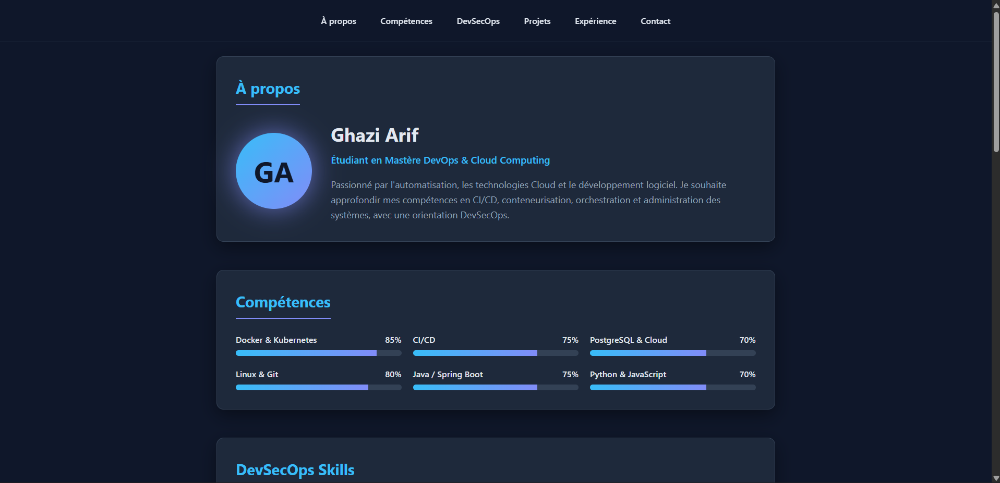

### 8️⃣ Section DevSecOps Skills

Création d'une grille CSS Grid présentant sept technologies : Git, Docker, Jenkins, Kubernetes, Ansible, Terraform et Argo CD.

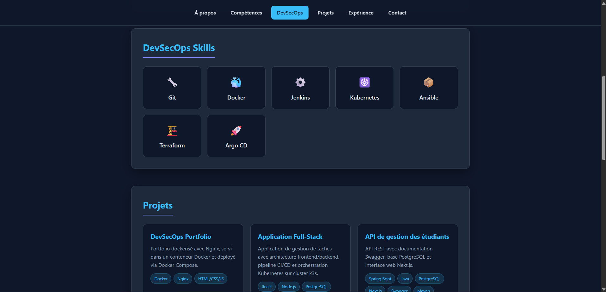

### 9️⃣ Projets dynamiques en JavaScript

```javascript
const projects = [
  {
    title: "DevSecOps Portfolio",
    description: "Portfolio conteneurisé",
    tech: ["Docker", "Nginx"]
  }
];

const projectsContainer = document.getElementById("projects");

projects.forEach((project) => {
  const card = document.createElement("div");
  card.className = "project-card";

  card.innerHTML = `
    <h3>${project.title}</h3>
    <p>${project.description}</p>
    <div class="tags">
      ${project.tech.map((tech) => `<span>${tech}</span>`).join("")}
    </div>
  `;

  projectsContainer.appendChild(card);
});
```

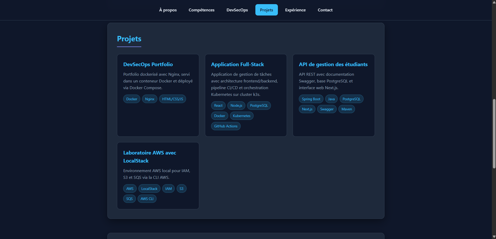

### 🔟 Dockerfile Nginx

```dockerfile
FROM nginx:alpine

COPY . /usr/share/nginx/html/

EXPOSE 80

CMD ["nginx", "-g", "daemon off;"]
```

| Instruction | Rôle |
|---|---|
| `FROM nginx:alpine` | Utilise une image Nginx légère |
| `COPY` | Copie les fichiers statiques |
| `EXPOSE 80` | Documente le port HTTP |
| `CMD` | Lance Nginx au premier plan |

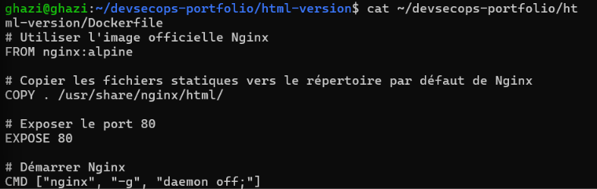

### 1️⃣1️⃣ Construction de l'image Docker

```bash
docker build -t cv-docker .
docker images | grep cv-docker
```

Résultat observé : `cv-docker:latest`.

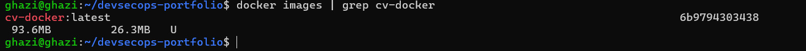

### 1️⃣2️⃣ Lancement du conteneur Docker

```bash
docker run -d -p 8081:80 --name cv-container cv-docker
```

Le port 8080 est utilisé par Jenkins ; le portfolio est donc exposé sur le port 8081.

Accès : `http://192.168.109.128:8081`

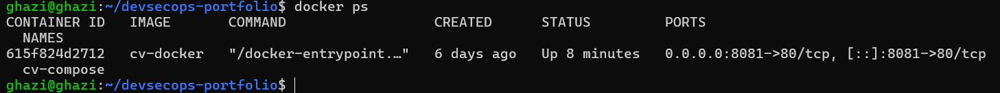

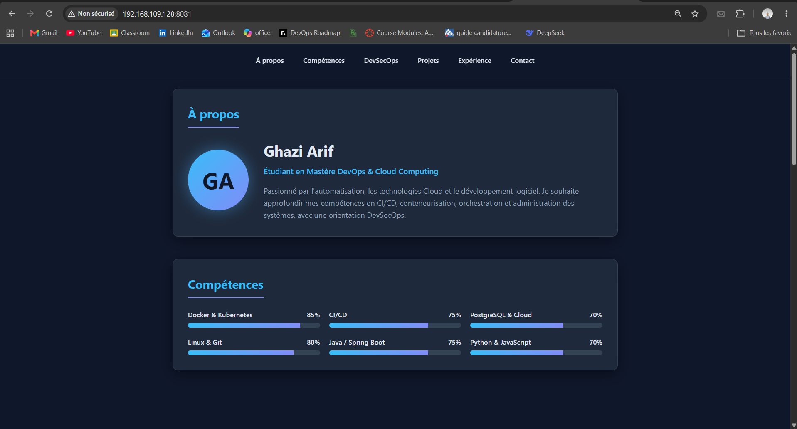

### 1️⃣3️⃣ Docker Compose

```yaml
services:
  portfolio:
    build: .
    image: cv-docker
    container_name: cv-compose
    ports:
      - "8081:80"
    restart: unless-stopped
```

Lancement :

```bash
docker compose up -d
docker compose ps
```

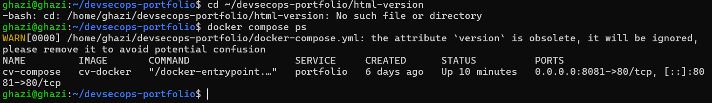

### 1️⃣4️⃣ Publication GitHub

Dépôt : [ghaziarif1/devsecops-portfolio](https://github.com/ghaziarif1/devsecops-portfolio)

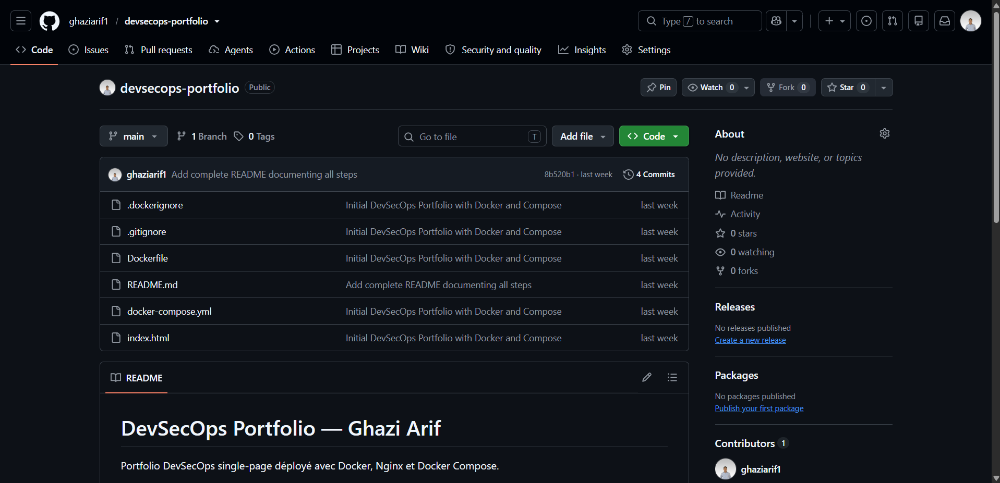

---

## III. Vagrant

### 1️⃣5️⃣ Installation de Vagrant et VirtualBox

Installation de Vagrant depuis le dépôt HashiCorp et de VirtualBox depuis les dépôts Ubuntu.

```bash
wget -O - https://apt.releases.hashicorp.com/gpg \
  | sudo gpg --dearmor \
      -o /usr/share/keyrings/hashicorp-archive-keyring.gpg

sudo apt install vagrant

sudo add-apt-repository multiverse
sudo apt install virtualbox
```

Versions indiquées : Vagrant 2.4.9 et VirtualBox 7.2.6.

Exemple de `Vagrantfile` :

```ruby
Vagrant.configure("2") do |config|
  config.vm.box = "ubuntu/jammy64"
  config.vm.hostname = "vagrant-ubuntu"

  config.vm.provider "virtualbox" do |vb|
    vb.memory = "2048"
    vb.cpus = 2
  end

  config.vm.provision "shell", inline: <<-SHELL
    apt update && apt upgrade -y
    apt install -y openssh-server
    systemctl enable --now ssh
  SHELL
end
```

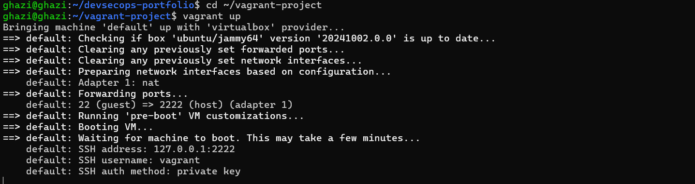

### 1️⃣6️⃣ Connexion à la VM Vagrant

```bash
cd ~/vagrant-project
vagrant ssh
```

La connexion ouvre une session sur la machine virtuelle `vagrant-ubuntu`.

| Critère | Installation manuelle | Vagrant |
|---|---|---|
| Temps | Plus long | Automatisé |
| Reproductibilité | Limitée | Élevée |
| Configuration | Manuelle | `Vagrantfile` versionné |

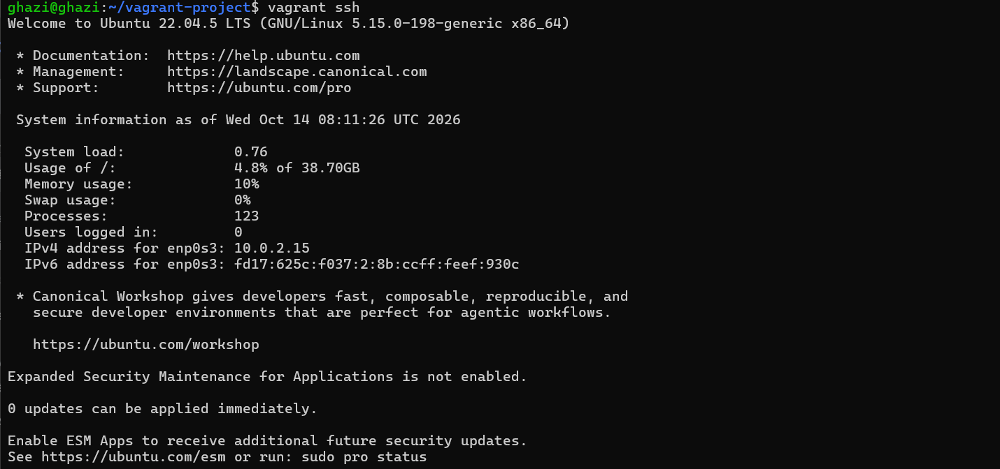

### 1️⃣7️⃣ Préparation de l'environnement

Préparation de l'environnement de virtualisation et validation de la configuration avant la migration vers une architecture frontend moderne.

---

## IV. Portfolio HTML/CSS/JS

La première version est un portfolio statique construit en HTML, CSS et JavaScript, puis conteneurisé avec Docker et Nginx.

Elle utilise des données locales et constitue la base du projet avant la migration vers Next.js.

---

## V. Migration Next.js

### 1️⃣8️⃣ Création du projet Next.js

```bash
npx create-next-app@latest devsecops-portfolio-next --yes
cd devsecops-portfolio-next
npm run dev -- -H 0.0.0.0
```

Accès : `http://192.168.109.128:3000`

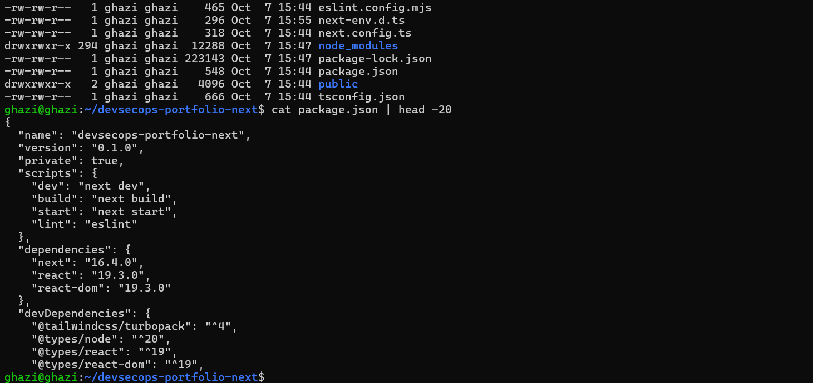

### 1️⃣9️⃣ Composants réutilisables

| Composant | Rôle |
|---|---|
| `Header` | Navigation fixe avec ancres |
| `About` | Présentation personnelle |
| `Skills` | Compétences techniques |
| `DevSecOpsSkills` | Grille des technologies DevSecOps |
| `Projects` | Cartes de projets dynamiques |
| `Experience` | Parcours académique et professionnel |
| `Contact` | Coordonnées |
| `Footer` | Pied de page |

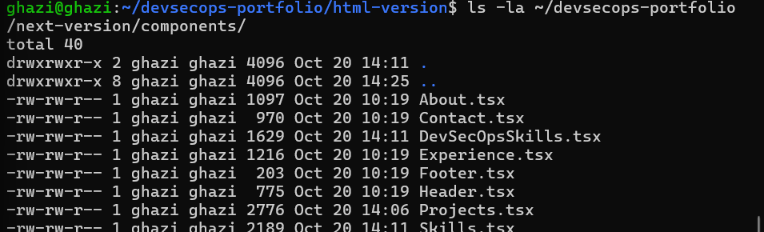

### 2️⃣0️⃣ Séparation des données

Exemple de `data/projects.ts` :

```typescript
export interface Project {
  slug: string;
  title: string;
  description: string;
  longDescription: string;
  tech: string[];
}

export const projects: Project[] = [
  {
    slug: "devsecops-portfolio",
    title: "DevSecOps Portfolio",
    description: "Portfolio dockerisé avec Nginx",
    longDescription: "Présentation détaillée du projet.",
    tech: ["Docker", "Nginx", "Next.js"]
  }
];
```

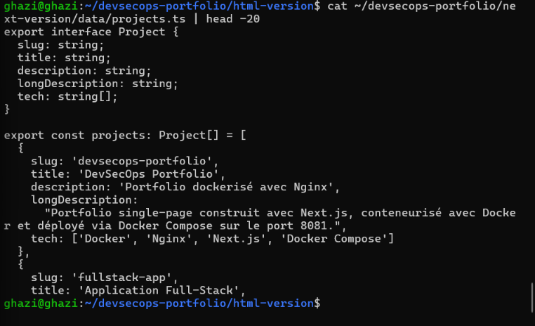

### 2️⃣1️⃣ Pages dédiées aux projets

- `/projects` : liste des projets.
- `/projects/[slug]` : page de détail d'un projet.

Exemple pour Next.js 15+ :

```tsx
import { notFound } from "next/navigation";
import { projects } from "@/data/projects";

type Props = {
  params: Promise<{ slug: string }>;
};

export default async function ProjectPage({ params }: Props) {
  const { slug } = await params;
  const project = projects.find((item) => item.slug === slug);

  if (!project) {
    notFound();
  }

  return (
    <div>
      <h1>{project.title}</h1>
      <p>{project.description}</p>
    </div>
  );
}
```

**Remarque :** dans Next.js 15+, `params` est une Promise dans les pages concernées.

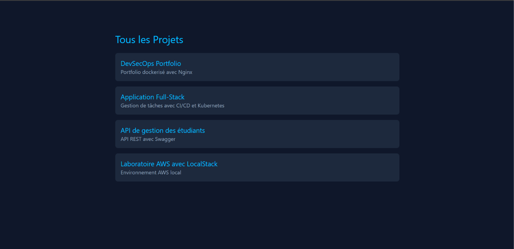

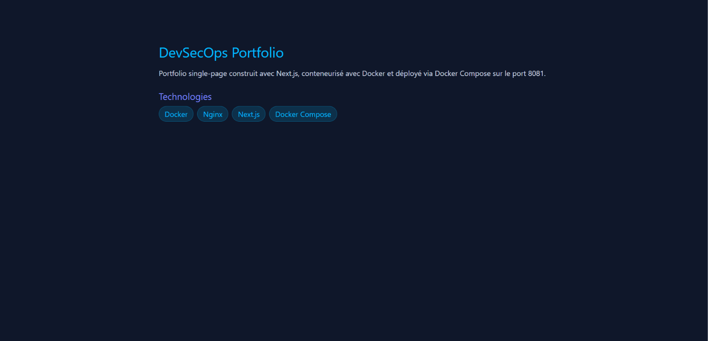

---

## VI. Jenkins Pipeline

### 2️⃣2️⃣ Pipeline initial

Exemple de `Jenkinsfile` :

```groovy
pipeline {
    agent any

    stages {
        stage('Checkout') {
            steps {
                checkout scm
                sh 'git log --oneline -3'
            }
        }
    }
}
```

Configuration : Multibranch Pipeline avec le dépôt GitHub `git@github.com:ghaziarif1/devsecops-portfolio.git`.


### 2️⃣3️⃣ Installation des dépendances

Le plugin NodeJS est configuré dans **Manage Jenkins → Tools** avec une installation Node.js 22 nommée `NodeJS22`.

```groovy
tools {
    nodejs 'NodeJS22'
}

stage('Install Dependencies') {
    steps {
        dir('next-version') {
            sh 'node --version'
            sh 'npm ci'
        }
    }
}
```


### 2️⃣4️⃣ Build Next.js

```groovy
stage('Build') {
    steps {
        dir('next-version') {
            sh 'npm run build'
        }
    }
}
```

Le build vérifie la compilation du frontend et la génération des routes Next.js.

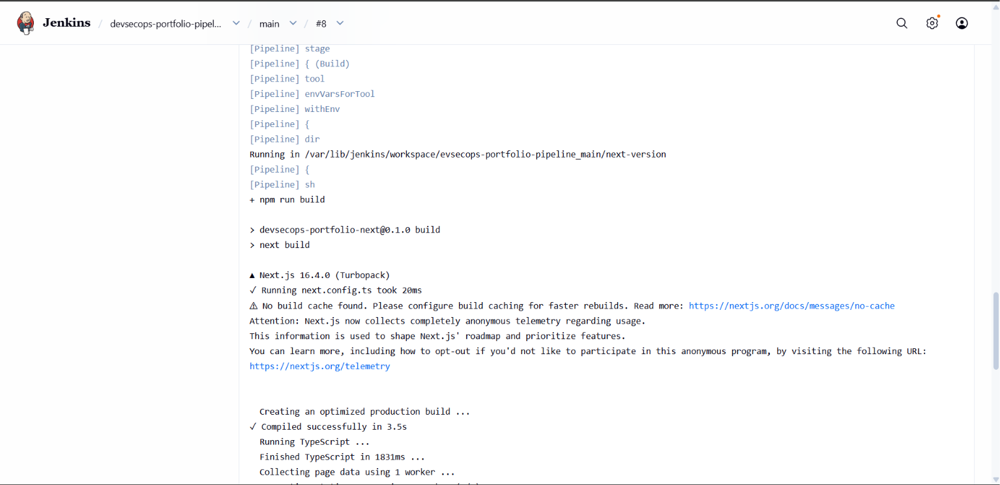


---

## VII. Ansible

### 2️⃣5️⃣ Installation d'Ansible sur la VM admin

```bash
sudo apt install -y ansible
ansible --version
```

Version indiquée : Ansible Core 2.20.1.

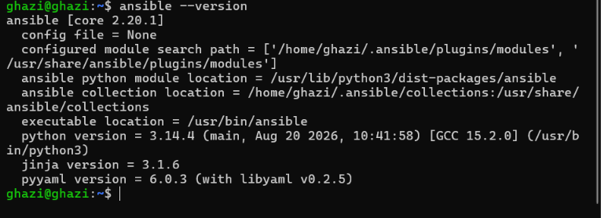

### 2️⃣6️⃣ Inventory et premier ping

Exemple de `inventory.ini` :

```ini
[servers]
ubuntu-server ansible_host=192.168.109.128 ansible_user=ghazi

[all:vars]
ansible_python_interpreter=/usr/bin/python3
```

Test de connectivité :

```bash
ansible all -i inventory.ini -m ping
```

Résultat attendu :

```text
ubuntu-server | SUCCESS => {
    "ping": "pong"
}
```

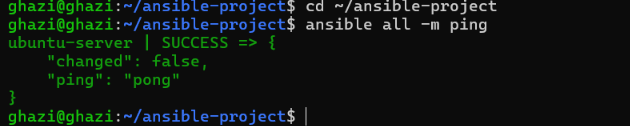

### 2️⃣7️⃣ Playbook d'installation de Git

```yaml
---
- name: Installer Git sur le serveur Ubuntu
  hosts: servers
  become: true

  tasks:
    - name: Mettre à jour le cache apt
      ansible.builtin.apt:
        update_cache: true

    - name: Installer Git
      ansible.builtin.apt:
        name: git
        state: present

    - name: Vérifier la version de Git
      ansible.builtin.command: git --version
      register: git_version
      changed_when: false

    - name: Afficher la version
      ansible.builtin.debug:
        msg: "Git installé : {{ git_version.stdout }}"
```

Exécution :

```bash
ansible-playbook -i inventory.ini install-git.yml
```

Résultat observé : installation réussie et idempotence vérifiée lors d'une nouvelle exécution.

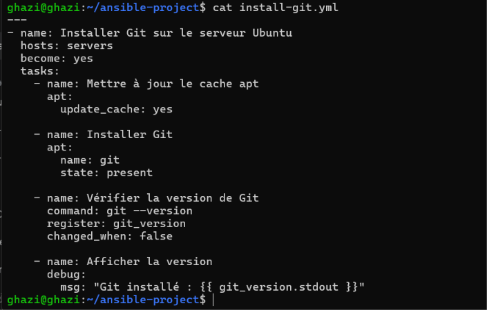

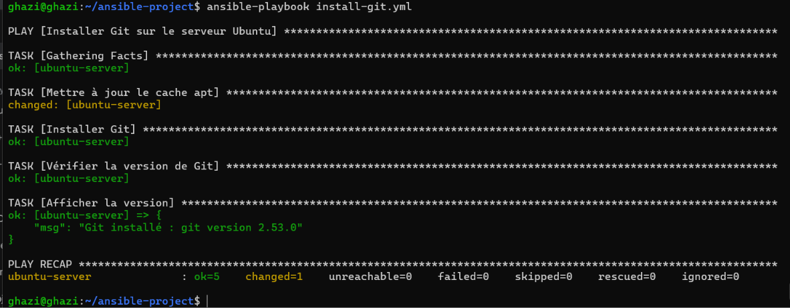

### 2️⃣8️⃣ Playbook d'installation de Docker

```yaml
---
- name: Installer Docker sur le serveur Ubuntu
  hosts: servers
  become: true

  tasks:
    - name: Installer les prérequis
      ansible.builtin.apt:
        name:
          - ca-certificates
          - curl
          - gnupg
        state: present
        update_cache: true

    - name: Créer le dossier keyrings
      ansible.builtin.file:
        path: /etc/apt/keyrings
        state: directory
        mode: "0755"

    - name: Ajouter la clé GPG Docker
      ansible.builtin.shell: |
        curl -fsSL https://download.docker.com/linux/ubuntu/gpg |
          gpg --dearmor -o /etc/apt/keyrings/docker.gpg
      args:
        creates: /etc/apt/keyrings/docker.gpg

    - name: Ajouter le dépôt Docker
      ansible.builtin.copy:
        dest: /etc/apt/sources.list.d/docker.list
        mode: "0644"
        content: |
          deb [arch=amd64 signed-by=/etc/apt/keyrings/docker.gpg] https://download.docker.com/linux/ubuntu jammy stable

    - name: Installer Docker
      ansible.builtin.apt:
        name:
          - docker-ce
          - docker-ce-cli
          - containerd.io
          - docker-compose-plugin
        state: present
        update_cache: true

    - name: Démarrer Docker
      ansible.builtin.systemd:
        name: docker
        state: started
        enabled: true

    - name: Vérifier la version
      ansible.builtin.command: docker --version
      register: docker_version
      changed_when: false

    - name: Afficher la version
      ansible.builtin.debug:
        msg: "Docker installé : {{ docker_version.stdout }}"
```

**Attention :** l'exemple de dépôt ci-dessus utilise `jammy`. Il faut adapter le nom de la distribution à la version Ubuntu réellement utilisée sur la machine cible.

Exécution :

```bash
ansible-playbook -i inventory.ini install-docker.yml
```

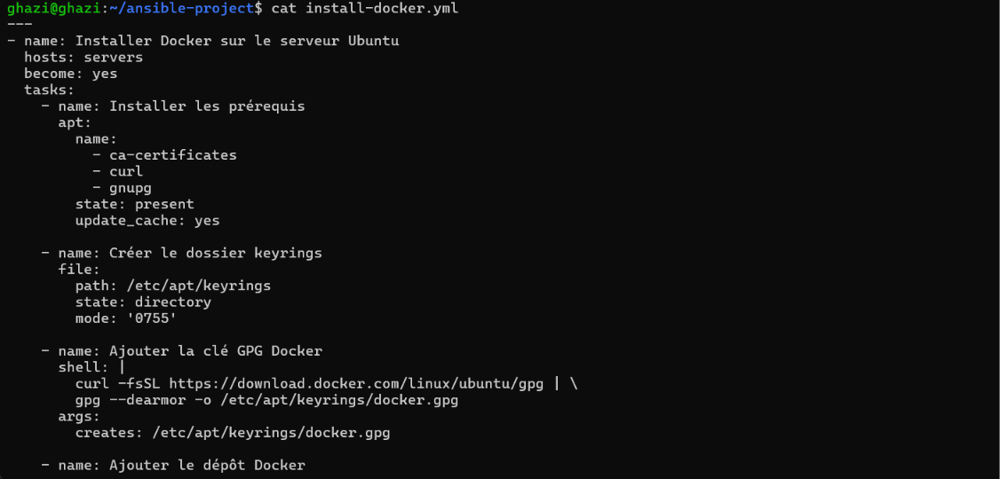

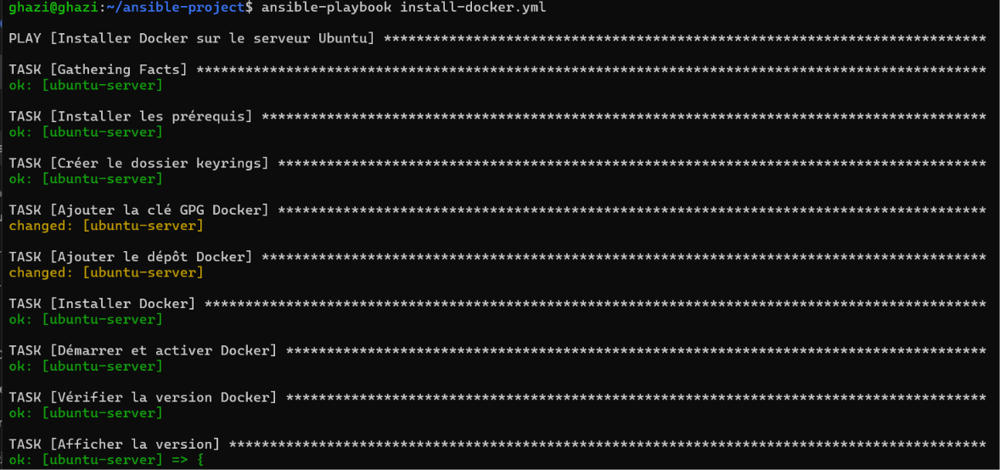

---

## VIII. API Express

### 2️⃣9️⃣ Application Express

Structure de l'API :

```text
api/
├── package.json
├── src/
│   ├── index.js
│   ├── routes/
│   │   ├── health.js
│   │   ├── profile.js
│   │   ├── projects.js
│   │   └── skills.js
│   └── data/
│       ├── profile.json
│       ├── projects.json
│       └── skills.json
└── Dockerfile
```

Lancement :

```bash
cd api
npm install
npm run dev
```

L'API écoute sur le port 4000.

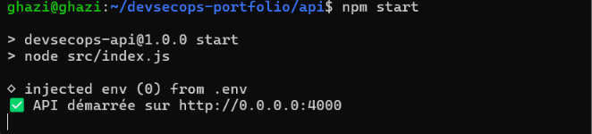

### 3️⃣0️⃣ Route `GET /api/health`

```bash
curl -s http://192.168.109.128:4000/api/health | python3 -m json.tool
```

Exemple de réponse :

```json
{
  "status": "ok",
  "service": "devsecops-api",
  "version": "1.0.0",
  "timestamp": "2026-10-20T...",
  "uptime": 42.64
}
```

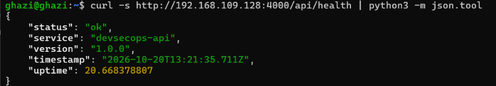

### 3️⃣1️⃣ Route `GET /api/profile`

```bash
curl -s http://192.168.109.128:4000/api/profile | python3 -m json.tool
```

Cette route retourne les informations de profil configurées dans l'API.

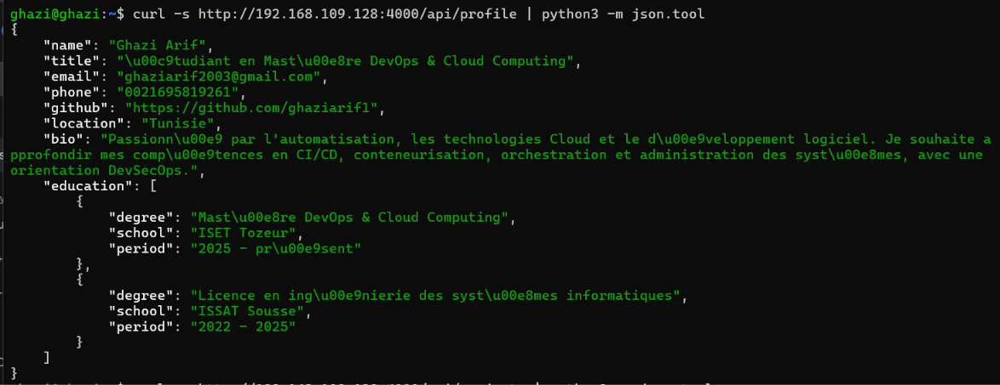

### 3️⃣2️⃣ Route `GET /api/projects`

```bash
curl -s http://192.168.109.128:4000/api/projects | python3 -m json.tool
```

Cette route retourne la liste des projets du portfolio.

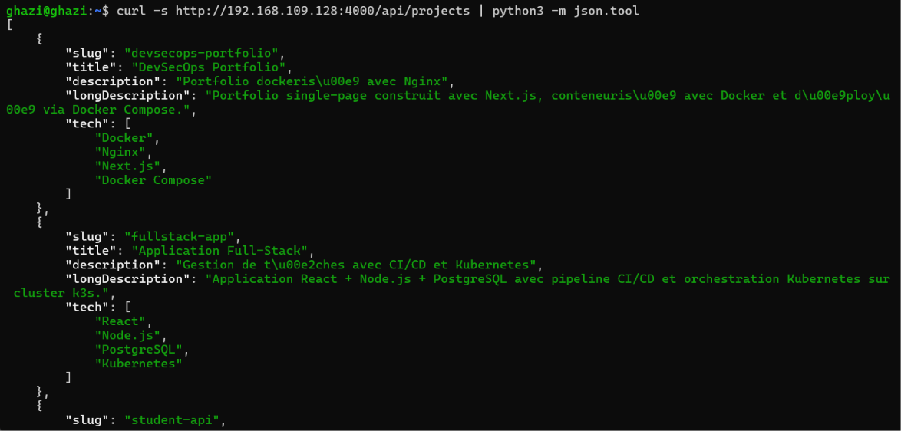

### 3️⃣3️⃣ Route `GET /api/skills`

```bash
curl -s http://192.168.109.128:4000/api/skills | python3 -m json.tool
```

Cette route retourne les compétences techniques et DevSecOps.

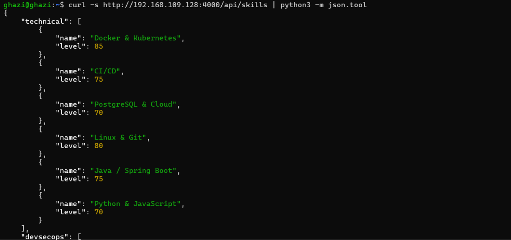

### 3️⃣4️⃣ Frontend Next.js consommant `/api/projects`

Exemple de consommation de l'API depuis un composant client :

```tsx
'use client';

import { useEffect, useState } from 'react';

type Project = {
  title: string;
  description: string;
};

export default function Projects() {
  const [projects, setProjects] = useState<Project[]>([]);

  useEffect(() => {
    const apiUrl =
      process.env.NEXT_PUBLIC_API_URL || 'http://localhost:4000';

    fetch(`${apiUrl}/api/projects`)
      .then((response) => {
        if (!response.ok) {
          throw new Error('Erreur lors du chargement des projets');
        }

        return response.json();
      })
      .then(setProjects)
      .catch(console.error);
  }, []);

  return (
    <section>
      <h2>Mes projets</h2>

      {projects.map((project, index) => (
        <article key={`${project.title}-${index}`}>
          <h3>{project.title}</h3>
          <p>{project.description}</p>
        </article>
      ))}
    </section>
  );
}
```

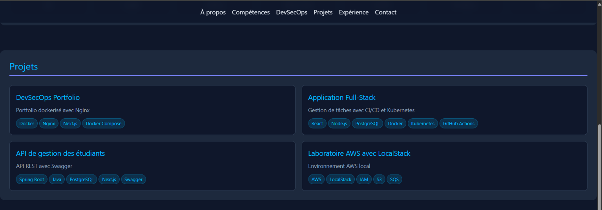

### 3️⃣5️⃣ Frontend Next.js consommant `/api/skills`

La même approche est utilisée pour charger les compétences dans `Skills.tsx` et `DevSecOpsSkills.tsx`.

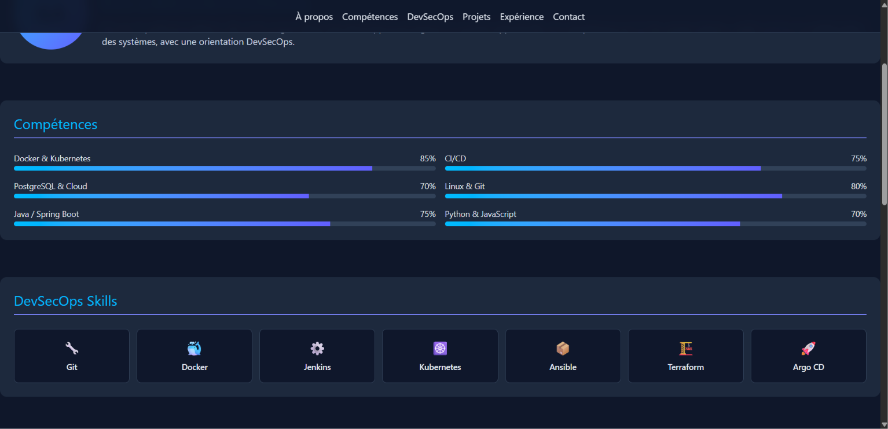

---

## IX. Variables d'environnement

### 3️⃣6️⃣ Configuration de `NEXT_PUBLIC_API_URL`

Exemple de `next-version/.env.local` :

```dotenv
NEXT_PUBLIC_API_URL=http://192.168.109.128:4000
```

Pourquoi utiliser une variable d'environnement ?

- **Portabilité :** l'URL peut changer entre développement, Docker et production.
- **Configuration :** l'infrastructure est séparée du code applicatif.
- **Collaboration :** chaque développeur peut définir sa propre configuration.
- **Frontend :** le préfixe `NEXT_PUBLIC_` expose la variable au navigateur ; il ne faut donc jamais y placer de secrets.

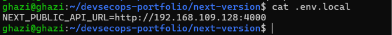

### 3️⃣7️⃣ Fichiers `.env.example`

Exemple de `next-version/.env.example` :

```dotenv
NEXT_PUBLIC_API_URL=http://localhost:4000
```

Exemple de `api/.env.example` :

```dotenv
PORT=4000
CORS_ORIGIN=http://localhost:3000
NODE_ENV=development
```

**Bonne pratique DevSecOps :** versionner les fichiers `.env.example`, mais exclure les fichiers contenant des configurations locales ou des secrets, tels que `.env.local`.

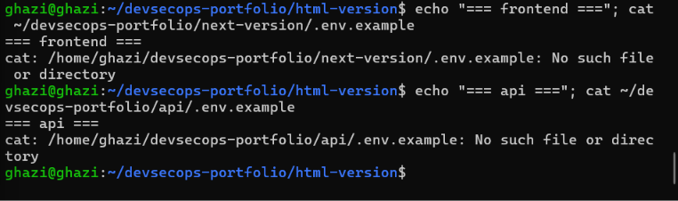

---

## X. Dockerisation complète

### 3️⃣8️⃣ Dockerfile Next.js multi-stage

Exemple de Dockerfile pour Next.js :

```dockerfile
FROM node:22-alpine AS deps
WORKDIR /app

COPY package.json package-lock.json ./
RUN npm ci

FROM node:22-alpine AS builder
WORKDIR /app

COPY --from=deps /app/node_modules ./node_modules
COPY . .

ARG NEXT_PUBLIC_API_URL=http://192.168.109.128:4000
ENV NEXT_PUBLIC_API_URL=$NEXT_PUBLIC_API_URL
ENV NEXT_TELEMETRY_DISABLED=1

RUN npm run build

FROM node:22-alpine AS runner
WORKDIR /app

ENV NODE_ENV=production

RUN addgroup --system --gid 1001 nodejs && \
    adduser --system --uid 1001 nextjs

COPY --from=builder /app/public ./public
COPY --from=builder --chown=nextjs:nodejs /app/.next/standalone ./
COPY --from=builder --chown=nextjs:nodejs /app/.next/static ./.next/static

USER nextjs

EXPOSE 3000

CMD ["node", "server.js"]
```

**Prérequis :** activer `output: "standalone"` dans la configuration Next.js pour générer le dossier `.next/standalone`.

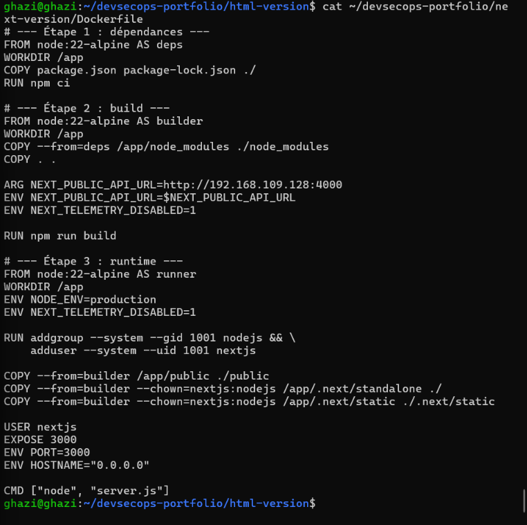

### 3️⃣9️⃣ Dockerfile API

```dockerfile
FROM node:22-alpine

WORKDIR /app

COPY package.json package-lock.json ./
RUN npm ci --omit=dev

COPY src ./src

ENV NODE_ENV=production

EXPOSE 4000

CMD ["node", "src/index.js"]
```

Cette image exclut les dépendances de développement.

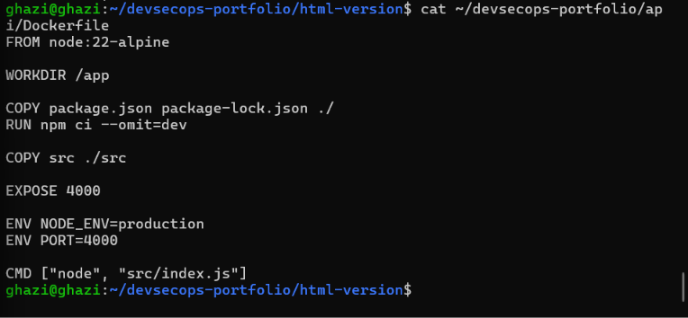

### 4️⃣0️⃣ Construction des images Docker

Depuis la racine du dépôt :

```bash
docker build -t devsecops-api ./api
docker build -t devsecops-portfolio ./next-version
docker images | grep devsecops
```

Exemple de sortie observée :

```text
devsecops-api          latest   249MB
devsecops-portfolio    latest   333MB
```

Les tailles réelles dépendent des versions, des dépendances et de la configuration de construction.

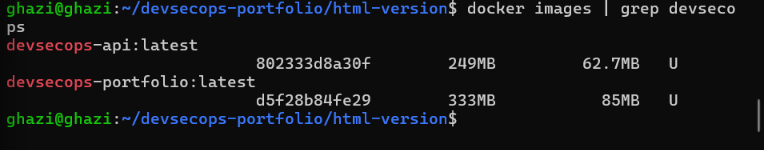

### 4️⃣1️⃣ Orchestration Docker Compose

Exemple de `docker-compose.yml` à la racine :

```yaml
services:
  api:
    build: ./api
    image: devsecops-api
    ports:
      - "4000:4000"
    networks:
      - devsecops-net

  portfolio:
    build:
      context: ./next-version
      args:
        NEXT_PUBLIC_API_URL: http://192.168.109.128:4000
    image: devsecops-portfolio
    ports:
      - "3002:3000"
    depends_on:
      - api
    networks:
      - devsecops-net

networks:
  devsecops-net:
    driver: bridge
```

Démarrage et vérification :

```bash
docker compose up -d
docker compose ps
```

Exemple de sortie :

```text
NAME                   STATUS          PORTS
devsecops-api          Up              0.0.0.0:4000->4000/tcp
devsecops-portfolio    Up              0.0.0.0:3002->3000/tcp
```

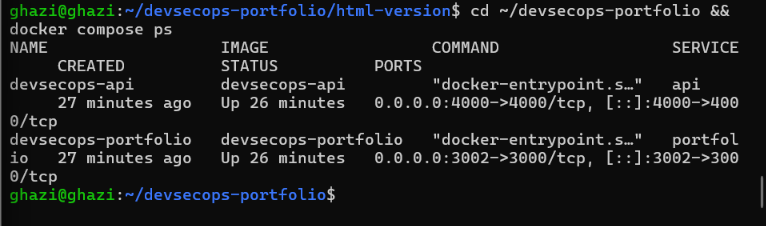

### 4️⃣2️⃣ Vérification de la communication entre conteneurs

Test interne au réseau Docker :

```bash
docker compose exec portfolio sh -c \
  "wget -qO- http://api:4000/api/health"
```

Exemple de réponse :

```json
{
  "status": "ok",
  "service": "devsecops-api"
}
```

Ce test démontre que le conteneur `portfolio` peut joindre le conteneur `api` grâce au DNS interne Docker et au réseau `devsecops-net`.

**Accès depuis Windows :** `http://192.168.109.128:3002`

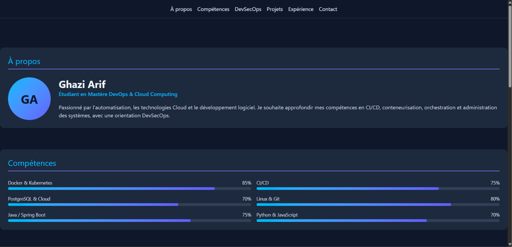

---

## 🎓 Compétences démontrées

| Compétence | Mise en œuvre |
|---|---|
| Administration Linux | Ubuntu Server, SSH, UFW, systemd |
| Conteneurisation | Docker, Dockerfiles multi-stage, Docker Compose, réseau bridge |
| CI/CD | Jenkins Multibranch Pipeline et Jenkinsfile |
| Infrastructure as Code | Ansible et Vagrant |
| Frontend moderne | HTML/CSS/JS, Next.js 16, TypeScript, Tailwind CSS |
| Backend | Node.js, Express et API REST |
| Sécurité | Authentification SSH par clé, gestion des variables d'environnement, conteneurs non-root |
| Réseau Docker | Communication inter-conteneurs via DNS interne |

---

## 👤 Auteur

<div align="center">

### Ghazi Arif

Étudiant en Mastère DevOps & Cloud Computing — ISET Tozeur

[](mailto:ghaziarif2003@gmail.com)

[](https://github.com/ghaziarif1)

⭐ Si ce projet vous a été utile, n'hésitez pas à lui donner une étoile ! ⭐

<sub>Projet réalisé dans le cadre du Mastère DevOps & Cloud Computing — ISET Tozeur, 2026.</sub>

</div>
